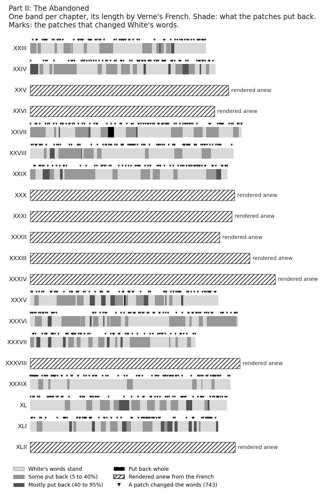
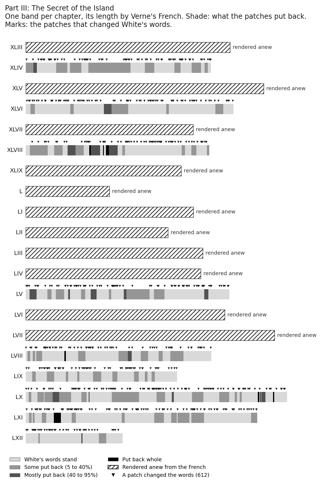

# The Map of the Restoration

*One band for each of Verne’s chapters, its length by his French, drawn from the patches made. The band’s shade shows how much of each passage the patches put back where White cut it: light where his words stand, darker as more was put back, black where a whole passage he dropped was restored. The marks above a band are the patches that changed what White said. A hatched band is a chapter written anew from the French in White’s English; the dotted band is XIX bis, which has no French. The counts follow the map.*

