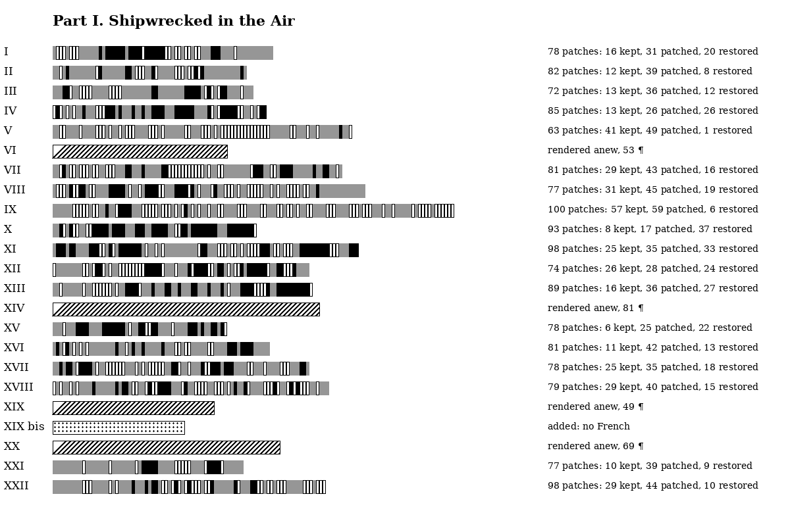

# The Map of the Restoration

*One row for each of Verne’s chapters, one cell for each of his paragraphs, from his first chapter to his last. White: White’s words stand as he wrote them. Grey: a patch changed them to agree with the French. Black: words White cut, or a paragraph he dropped, put back. Hatched: the chapter written anew from the French in White’s English. Dotted: XIX bis, which has no French. Each French paragraph takes the mark of the White paragraph that renders it. The counts at the right are the patches made in that chapter, and its paragraphs by mark.*

